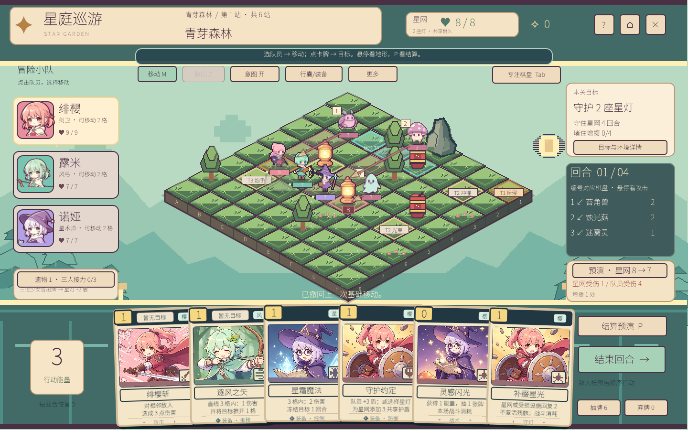

# 星庭巡游 · STAR GARDEN

用推移、阻挡和地形，守住星灯网络。单人战术卡牌游戏，Windows 免费开发试玩。

- 游戏介绍：https://wusar.github.io/star-garden/
- Windows 下载：https://github.com/wusar/star-garden/releases/tag/v56
- 问题反馈：https://github.com/wusar/star-garden/issues

## 开始试玩

下载 Release 中的 `StarGarden-v56-windows-playtest.zip`，完整解压，双击 `独立试玩.cmd`。请保留同目录的 `StarGarden.pck`。

独立试玩不会读取或覆盖已有旅程和设置；关闭后本次进度清空。使用 `StarGarden.exe` 可以保存正常旅程。

## 玩法

8×8 棋盘上，敌人提前亮出攻击意图。带领三位伙伴，用移动、推拉、换位、防护和地形连锁保护多座星灯。装备自带卡牌，在营火打磨装备或精修卡牌。

点击队员和绿色空地移动；点击手牌和合法目标出牌。右键查看卡牌，P 预演，空格结束回合，Z 撤回基础移动，Esc 取消或打开设置。

## 当前状态

V56 开发试玩，2026-10-25。首局体验、画面与平衡仍在调整。部分小窗口文字偏小，一些装备共用卡图。部分插画和开发使用 AI 辅助，美术来源及公开再分发许可仍在核对；试玩包内保留素材状态与第三方许可证。

本仓库提供介绍网页与试玩下载入口，不包含开发工程、参考代码或用户录屏。不对游戏美术素材授予额外使用权。

## 网页开发

这是无依赖的静态 HTML/CSS/JS 网站，直接由 GitHub Pages 从 `main` 根目录部署。开发时可执行 `python -m http.server 4173`。

设计参考及素材清单见 [DESIGN.md](DESIGN.md)。网页无需第三方 CDN、Cookie 或统计脚本。
